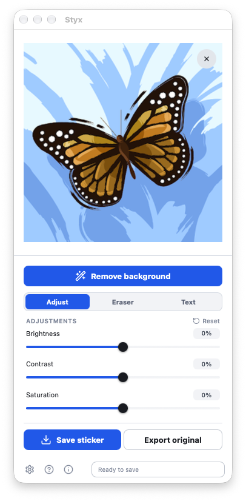
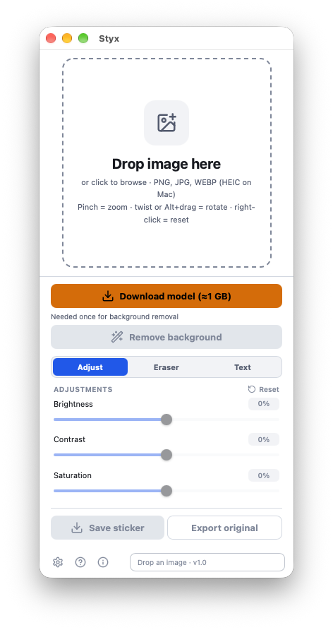
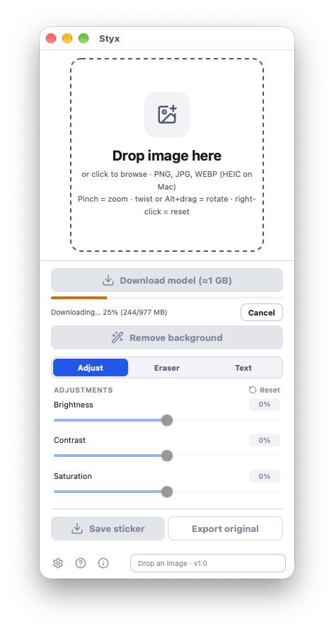
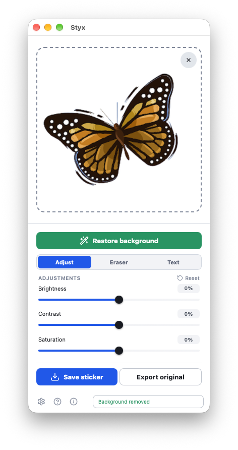

# Styx

Desktop Telegram sticker maker. Drop an image, adjust it, remove the background if needed, and export a 512×512 PNG under 512 KB ready for `@Stickers`.

Everything runs locally — no Python, no cloud APIs, images never leave your computer.



## Features & Controls

- **Canvas:** drag to move, scroll or pinch to zoom (`50–200%`), `Alt + drag` / `Alt + scroll` / two-finger twist to rotate, right-click to reset, `×` to clear.
- **Adjustments:** Brightness, Contrast, and Saturation (`-100%` to `+100%`), saved automatically when exporting a sticker.
- **Background removal:** local **BRIA RMBG 2.0** (`≈1 GB` ONNX model). Downloaded once on click with SHA-256 verification, then works offline. Weights are not bundled.
- **Eraser:** brush tool with adjustable **Size** (`4–80 px`), **Opacity** (`10–100%`), and **Hardness** (`0–100%`), plus **Undo** (`Cmd/Ctrl + Z`) and **Reset**. Hold `Space + drag` to pan the image without leaving Eraser.
- **Text:** add and edit captions directly on the sticker with 8 bundled offline fonts (Montserrat, Oswald, Poiret One, Lobster, Lora, Comfortaa, Caveat, Press Start 2P), weight toggle (`L`/`R`/`B`/`B+`), style cycle (**Light fill** / **Dark fill** / **Plain** with auto-contrast), color picker, **Size**, **Opacity** (`10–100%` for pill or plain text), and **Rotation** (`-180°` to `+180°`).
- **Export:** **Save sticker** (`512×512` PNG, `≤ 512 KB`) and **Export original** (full size with adjustments).
- **Formats:** PNG, JPG, WEBP, BMP, GIF, TIFF (+ HEIC/HEIF on macOS via system codecs). Output is always PNG.
- **Settings:** custom output folder (defaults to next to the source file) and Dark / Light theme.

<details>
<summary>More screenshots</summary>





</details>

## Download

Prebuilt installers are on the [Releases](../../releases) page.

> **macOS note:** builds are not signed with an Apple Developer certificate, so after dragging `Styx.app` to **Applications**, macOS Gatekeeper may show *"Styx.app is damaged and can't be opened"*. The app is safe — Apple displays this warning for unsigned apps downloaded from the internet. Remove the quarantine attribute in Terminal:
>
> ```bash
> xattr -cr /Applications/Styx.app
> ```

## Build from source

Requires macOS 11+ (or Windows 10/11), Rust (stable), and Node.js 20+.

```bash
npm install
npm run tauri dev     # development
npm run tauri build   # production bundle
```

If you distribute a fork, change `identifier` in `src-tauri/tauri.conf.json` so it does not share settings or the model cache with the original app.

## Uninstall (macOS)

```bash
rm -rf ~/Library/Application\ Support/com.threxal.styx \
       ~/Library/Caches/com.threxal.styx \
       ~/Library/WebKit/com.threxal.styx \
       ~/Library/Preferences/com.threxal.styx.plist \
       ~/Library/Saved\ Application\ State/com.threxal.styx.savedState \
       ~/.styx.json
```

## License

- App code: **MIT** — see [LICENSE](LICENSE)
- Background removal model (**BRIA RMBG 2.0**): **CC BY-NC 4.0** (non-commercial)
- Third-party components: [THIRD-PARTY-LICENSES.md](THIRD-PARTY-LICENSES.md)
- Author: [unconform](https://t.me/unconform)
